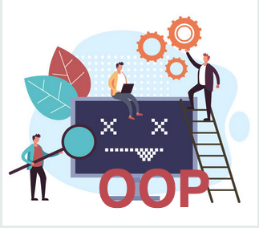

[TOC]

# Was heisst Objektorientiert Programmieren?

---
### Lernziel: 
* Ich kenne den Unterschied zwischen prozeduralem und objektorientiertem Programmieren

-- 

### Abgrenzung zu prozeduralem Programieren

Beim prozeduralem Programmieren geht es darum ein Problem (oder eine Aufgabe) mit Prozeduren zu lösen. Prozeduren sind dabei Anweisungen, die in einer bestimmten Reihenfolge ablaufen.
Prozeduren verwenden **Variablen**, **Entscheidungen** und **Schleifen**. Das Programm kann in Sub-Routinen(Funktionen) unterteilt werden. Das hat den Vorteil, dass eine Funktion z.Bsp. mehrmals aufgerufen und somit mehrmals verwendet werden kann.

Ein einfaches Beispiel wäre der Taschenrechner, wie wir es im M319 verwendet haben:

```java
public static void main(String[] args) {
		
		//variable deklarieren und default werte zuweisen
		int number1 = 0;
		int number2 = 0;
		char operator;
		float resultat;
		
		// Scanner:
		Scanner scan = new Scanner(System.in);
		
		System.out.println("Gib eine Zahl ein:");
		number1 = Integer.parseInt(scan.nextLine());
		System.out.println("Gib zweite Zahl ein:");
		number2 = Integer.parseInt(scan.nextLine());
		
		System.out.println("Was möchtest du rechnen? Gib +, -, * oder / ein");
		operator = scan.nextLine().charAt(0);
		// hier rufen wir die entsprechenden Funktionen auf:
		if (operator == '+') {
		resultat = addition(number1, number2);
		} else if (operator == '-') {
			resultat = subtraction(number1, number2);
		} else if (operator == '*') {
			resultat = multiply(number1, number2);
		} else if (operator == '/') {
			resultat = division(number1, number2);
		} else {
			System.out.println("You entered wrong input!");
		}
		
		//ausgabe des resultats:
		System.out.println("And the result is " + resultat);
		
	}
	
	 //Funktion die ein Resultat zurückgibt und zwar mit Datentyp float
	public static float addition(int number1, int number2) {
		return number1 + number2;
		
		
	}

```
Hier unterteilen wir die einzelnen Operationen in separate Funktionen, wie z.Bsp. addition().

---

### Was ist objekt-orientiert Programmieren (OOP)?

Bei OOP liegt der Fokus darauf, ein zu lösendes Problem auf Elemente in der realen Welt zu beziehen und das Problem in Bezug auf diese Objekte und ihr Verhalten darzustellen. 
Ein Objekt ist eine Datenstruktur, die einem realen Objekt sehr ähnlich ist. 
Objekte enthalten Datenfelder und Methoden, die Attribute und das Verhalten realer Objekte darstellen.

Objekte der realen Welt teilen alle zwei Eigenschaften: Sie alle haben Zustand und Verhalten. Eine objektorientierte Denkweise besteht darin, den Zustand und das Verhalten realer Objekte zu identifizieren. Die Komplexität von Objekten kann unterschiedlich sein, manche Objekte haben mehr mögliche Zustände und komplexere Verhaltensweisen als andere Objekte. 
Software-Objekte sind den realen Objekten konzeptionell ähnlich. Ein Objekt speichert seinen Zustand in Datenfeldern und definiert Verhaltensweisen über seine Methoden.

### Zwei Programmierparadigmen

Wir haben es somit mit zwei Programmier-Stilen zutun (oder auch: Programmierparadigmen). Beide haben unterschiedliche Herangehensweisen wie ein Problem durch ein Computerprogramm gelöst wird.

---

### Weitere Quellen (lesen und z.B. mit KI zusammenfassen lassen)

- https://entwickler.de/java/java-prozedural
- https://it-talents.de/it-wissen/prozedurale-vs-objektorientierte-programmierung/

---

#### Taschenrechner als Objekt 

Das obige Beispiel Taschenrechner, wie wir es im M320 mit dem **Objekt CalculatorApp**  programmieren würden:

```java
// Neu: Wir definieren eine Klasse CalculatorApp, um Daten (Zustand) und Verhalten (Methoden) zu kapseln.
// Warum: Objektorientierung ermöglicht bessere Struktur, Wiederverwendbarkeit und Testbarkeit.
import java.util.Scanner;

public class CalculatorApp {

    // Neu: Diese Felder sind Instanzvariablen (Zustand des Objekts).
    // Warum: Werte wie number1, number2 und operator gehören logisch zusammen
    // und werden so vom Objekt verwaltet, statt lose in main zu liegen.
    private int number1;
    private int number2;
    private char operator;

    // Neu: Scanner als Feld, damit er von Methoden genutzt werden kann.
    // Warum: Vermeidet wiederholte Übergaben und bündelt IO im Objekt.
    private final Scanner scan;

    // Neu: Konstruktor, der den Scanner initialisiert.
    // Warum: Stellt sicher, dass das Objekt in gültigem Zustand erzeugt wird.
    public CalculatorApp() {
        this.scan = new Scanner(System.in);
    }

    // Neu: Methode zum Einlesen der Eingaben.
    // Warum: Trennung der Verantwortlichkeiten (Input, Berechnung, Ausgabe).
    public void readInput() {
        System.out.println("Gib eine Zahl ein:");
        number1 = Integer.parseInt(scan.nextLine());

        System.out.println("Gib zweite Zahl ein:");
        number2 = Integer.parseInt(scan.nextLine());

        System.out.println("Was möchtest du rechnen? Gib +, -, * oder / ein");
        operator = scan.nextLine().charAt(0);
    }

    // Neu: Methode, die anhand des Operators die passende Operation ausführt und das Ergebnis zurückgibt.
    // Warum: Kapselt die Entscheidungslogik in einer eigenen Methode.
    public float calculate() {
        switch (operator) {
            case '+':
                return addition(number1, number2);
            case '-':
                return subtraction(number1, number2);
            case '*':
                return multiply(number1, number2);
            case '/':
                return division(number1, number2);
            default:
                // Neu: Gesteuertes Fehlermanagement durch Exception.
                // Warum: Verhindert die Weiterverwendung eines ungültigen Zustands und macht Fehler klar.
                throw new IllegalArgumentException("Falscher Operator eingegeben: " + operator);
        }
    }

    // Unverändert inhaltlich, aber als Instanzmethoden belassen könnte man ebenso static lassen.
    // Warum: Hier demonstrieren wir OOP, daher Instanzmethoden.
    public float addition(int number1, int number2) {
        return number1 + number2;
    }

    public float subtraction(int number1, int number2) {
        return number1 - number2;
    }

    public float multiply(int number1, int number2) {
        return number1 * number2;
    }

    public float division(int number1, int number2) {
        // Neu: Prüfung auf Division durch Null.
        // Warum: Verhindert Laufzeitfehler und liefert verständliche Rückmeldung.
        if (number2 == 0) {
            throw new ArithmeticException("Division durch 0 ist nicht erlaubt.");
        }
        // Explizites Cast, damit float-Division ausgeführt wird.
        return (float) number1 / number2;
    }
```
Das obige Objekt wird nun konkret aufgerufen in der **main-Funktion** (static; ist in der Klasse drin):

```java
    // Neu: main nutzt jetzt die Klasse, anstatt alles prozedural zu machen.
    // Warum: Einstiegspunkt bleibt, aber die Logik ist sauber gekapselt.
    public static void main(String[] args) {
        CalculatorApp app = new CalculatorApp();
        try {
            app.readInput();
            float resultat = app.calculate();
            System.out.println("And the result is " + resultat);
        } catch (Exception e) {
            System.out.println("Fehler: " + e.getMessage());
        }
    }
}

```

 **ToDo**: Sehen Sie die Unterschiede??

---

# Checkpoint

* Ich kann den Unterschied zwischen prozedural und objektorientiertem Programmieren erklären.
* Ich kenne den Begriff ***Programmierparadigma*** und kann ihn mit einem Beispiel erläutern.
