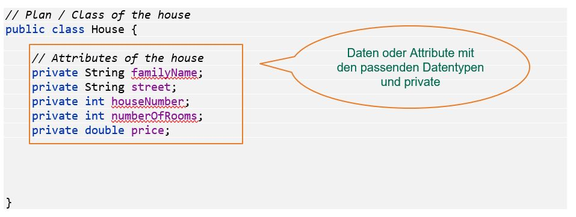
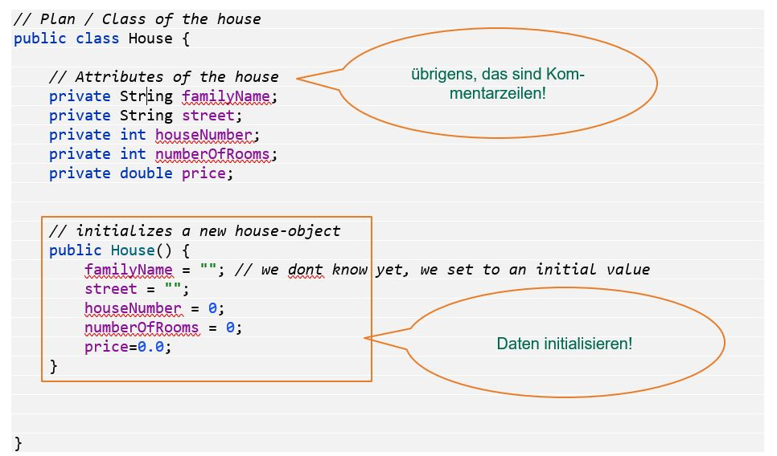
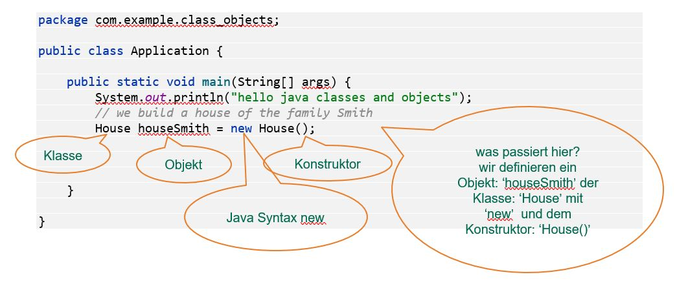

[TOC]

# Klassen und Objekte

---
### Lernziele: 
* Ich kenne den Unterschied zwischen Klassen und Objekten
* Ich weiss wie eine Klasse aufgebaut wird (Attribute, Konstruktoren, Methoden)
* Ich weiss wie man Objekte von einer Klasse erzeugen kann
* Ich weiss wie man den Zustand eines Objekts verändern kann
* Ich weiss wie man Methoden eines Objekts aufrufen kann

-- 

## Vom Bauplan und von Häusern ...

Lesen Sie nochmals die allgemeine Einführung in Klassen und Objekte durch. Im Modul 319 haben wir keine Klassen/Objekte erstellt, aber durchaus bestehende aus der Java-Bibliothek benutzt, z.B. String und ArrayList. 

[**&rarr; Einführung Objekte und Klassen** (M319)](https://gitlab.com/ch-tbz-it/Stud/m319/-/tree/main/N2-Classes_Objects_Methods?ref_type=heads)

 Erklärung: 16 min
[](https://tbzedu-my.sharepoint.com/:v:/g/personal/michael_kellenberger_tbz_ch/ESDRKqGc-PZZZZunDia9B0cBrHDwcKbR2ixHGIbmnkmluA?e=MuOegT&nav=eyJyZWZlcnJhbEluZm8iOnsicmVmZXJyYWxBcHAiOiJTdHJlYW1XZWJBcHAiLCJyZWZlcnJhbFZpZXciOiJTaGFyZURpYWxvZy1MaW5rIiwicmVmZXJyYWxBcHBQbGF0Zm9ybSI6IldlYiIsInJlZmVycmFsTW9kZSI6InZpZXcifX0%3D)


## Der Bauplan - die Klasse

In der Objekt orientierten Programmierung arbeiten wir mit Klassen. Das sind 
die Baupläne für die eigentlichen konkreten ‘Dinge’. Mit der Klasse können wir dann einzelne Objekte davon erzeugen.
Der Bauplan definiert was ‘gebaut’ oder erstellt wird. Wir wollen nun ein Haus bauen und gehen somit zu einem Architekten.

### Grundgerüst

Als erstes definieren wir ein Grundgerüst, indem wir eine Klasse **House** erstellen.


### Attribute

Welche Eigenschaften gehören zu einem Haus?  . . . . . . . Das hängt davon ab, was uns interessiert, bzw. was für unsere Applikation nötig ist. Wir möchten eigentlich wissen :
-	ja, wer wohnt denn in dem Haus?
-	wieviele Zimmer hat es?
-	an welcher Strasse ist das Haus gelegen?
-	an welcher Strassennummer?
-	ev. der Wert des Hauses 

Somit stellen wir folgende Attribute zusammen in der Klasse:



### Initialisierung mittels Konstruktor

Nun setzen wir **default** Werte (oder Anfangswerte), damit die Attribute einen ersten Wert haben, wenn wir das Haus-Objekt initialisieren. Wir setzen diese Anfangswerte im **Konstruktor**. Wie der Name schon sagt, wird mit dem Konstruktor das eigentliche Objekt erzeugt:



---

### Zugriff auf die Attribute via Getter und Setter

Um die Datenfelder zu lesen oder zu schreiben braucht es hier sogenannte getter und setter. Die Datenfelder bleiben von ausserhalb der Klasse geschützt, mittels **private**. Um diese zu lesen oder zu schreiben verwenden wir entsprechende Methoden, hier zum Beispiel für das Attribut FamilyName:

```
// getter and setter here
    public String getFamilyName() {
        return familyName;
    }

    public void setFamilyName(String familyName) {
        this.familyName = familyName;
    }

```

Achtung: Diese getter und setter Methoden sind mittlerweile ein Code-Standard und können somit in der IDE generiert werden. Diese Methoden schreibt man nicht selber.

### Wir erzeugen ein Objekt von House in einer Testklasse

Der Bauplan d.h. die Klasse House.java ist geschafft! wie geht es weiter? Wir haben zwar jetzt einen Bauplan des Hauses, als nächstes müsste ein spezielles Haus konkret gebaut werden z.B. ein Haus der Familie Smith and der Mainstreet 1291 in Palo Alto. Wir bauen nun eine Haus, natürlich nicht mit Beton sondern mit Java!

Wir wissen das Programm startet in der Methode main. Wir erstellen eine Testklasse wo wir diese main-Methode haben. Und von dort erzeugen wir ein Objekt des Hauses. 



Wir haben nun ein Haus ‘houseSmith’ gebaut/instanziert mit dem Bauplan/Klasse ‘House’ und dem Kon-struktor ‘House()’.
Was müssen wir beachten:
-	Klassennamen beginnen mit einem Grossbuchstaben, zusammengesetzte Wörter werden im CamelCase geschrieben z.B. HouseCity.
-	Die Klasse House wird in der Datei House.java gespeichert!
-	der Konstruktor hat den gleichen Namen der Klasse + ()!
-	Objektnamen starten klein und werden auch mit CamelCase beschrieben.


### Zustände eines Objekts ändern

Nun können wir die Attributswerte des Objekt setzen, indem wir die setter-Methoden aufrufen und jeweils einen Wert mitgeben.
Mit den getter-Methoden können wir Werte des Objekts auslesen und in der Konsole ausgeben. Ungefähr so:

```
String familyName = houseSmith.getFamilyName();
      System.out.println(familyName);

      System.out.println(houseSmith.getNumberOfRooms());

```


# Checkpoint
* Ich weiss wie man eine Klasse schreibt.
* Ich kann Objekte aus einer Klasse initialisieren.
* Ich kann den Zustand eines Objekts verändern.
