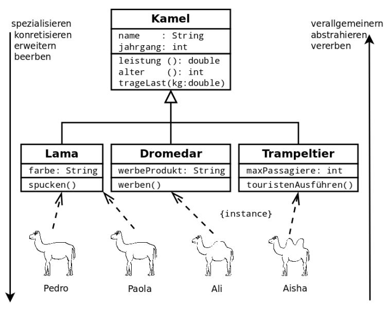

[TOC]

# Vererbung - kurze Einführung

---
### Lernziele: 
* Ich kann eine Hierarchie im Code mittels Vererbung abbilden
* Ich kann IST-Beziehungen im Code umsetzen
* Ich weiss wie man Interfaces für die eigene Klasse implementieren kann
-- 

### Code wiederverwenden durch Vererbung

Um Programmcode einzusparen, aber auch um Programmcode wieder zu verwenden,
wurde das Konzept der **Vererbung** geschaffen. Eine bereits bestehende Klasse kann einfach um
Attribute und Methoden erweitert werden, ohne den bestehenden Code verändern oder kopieren
zu müssen.

### Abstraktion mit Vererbung

Wie wir bereits gesehen haben, verwenden wir Klassen als Bauplan für Objekte. Unsere Klassen sind somit eine **Abstraktion** von realen Objekten, die wir im Code abbilden möchten.

Wir können nun eine weitere Abstraktion verwenden, indem wir bei bestehendem Code nach **Gemeinsamkeiten** suchen.
Bsp.: *Eine Hauskatze ist ein Säugetier*, *Tannen sind Nadelbäume*.
In beiden Fällen sprechen wir von einer **IST-Beziehung**. 

### Superklassen und Sub-Klassen

Wir können somit Gemeinsamkeiten in sog. **Superklassen** zusammenfassen. Dadurch wird unser Code übersichtlicher und wir haben die Gemeinsamkeiten in einer Klasse ausgelagert.
Folgende Darstellung zeigt das Prinzip der Vererbung:



Dieses UML Klassendiagramm zeigt das Prinzip der Vererbung:
Gemeinsame Attribute und Methoden sind in der Superklasse *Kamel* zusammengefasst. Die Sub-Klassen erben diese Attribute und Methoden und können sie verwenden oder auch erweitern (Stichwort: **überschreiben** oder **overriding**, welches wir noch später behandeln werden).

Somit haben wir zwei Faktoren:
* Eine **Verallgemeinerung** bei den Superklassen oder Oberklassen.
* Eine **Spezialisierung** bei den Sub-Klassen oder Unterklassen.

### Java Beispiel mit extends

```
public class Person {
    private String name ;
    private String vorname ;

    public void print () {
    System.out.println (" Nachname : ␣" + name );
    System.out.println (" Vorname : ␣ ␣" + vorname );
    }
}

public class Student extends Person {
    private String matrikelnummer ;
    public void printMatrikelnummer () {
    
    System.out.println (" Matrikelnummer : ␣ " + matrikelnummer );
}

```
Die Sub-Klasse *Student* erbt von der Superklasse *Person* durch das Keyword **extends**.


### Keyword super

Mit dem Keyword **super** kann die obere Klasse von den Sub-Klassen aufgerufen werden.
Wir verwenden dieses Keyword, wenn wir z.Bsp. den Konstruktor der Superklasse verwenden müssen.
Wir können durch dieses Keyword auch Methoden der Superklasse aufrufen.

Hier ein Beispiel:


```
public class Human {
	
	
	private String name;
	
	/**
	 * Constructor
	 */
	public Human(String name) {
		this.name = name;
		
	}
}

```
Die Klasse Human verwendet einen Konstruktor, bei dem das Attribut *Name* als Parameter übergeben wird.

Somit müssen Sub-Klassen diesen Konstruktor auch verwenden, damit das Attribut entsprechend gesetzt wird:

```
public class Apprentice extends Human{
	
	private String topic;
	
	public Apprentice(String topic, String name){
		super(name);
        this.topic = topic;
		
	}
}
```
**Super** ruft den Konstruktor von *Human* auf und übergibt den Wert der Variable *name*.

### Übung

Bilden Sie obigen Code als Beispiel ab. 
* Aufgabe: wie können wir den Namen des Lehrlings in der Sub-Klasse ausgeben, wenn wir die Attribute wie gewohnt auf *private* setzen? Zeigen Sie Ihre Lösung der Lehrperson.

---

### Abstrakte Klassen und Interfaces

Wir werden abstrakte Klassen und Interfaces später selber schreiben.
Java hat jedoch schon viele eigene Abstrakte Klassen und Interfaces die für Bibliotheksklassen oder als Hilfe verwendet werden.

Ein Beispiel wäre das Interface *List* welches in von der *Collections* Bibliothek verwendet wird. Die uns bekannte Klasse *ArrayList* implementiert *List* und verwendet somit die vordefinierten Methoden (z.bsp. add(), contains, get(), etc.). </br>

Ein weiteres Beispiel wäre das Interface *Iterator*, welches wir verwenden können, um über eine Liste von Elementen zu iteriieren. Das Interface hat die Methoden hasNext(), next() und remove().
Wenn wir eine eigene Datenstruktur einsetzen möchten (z.Bsp. eine eigene Stack Klasse), dann können wir den Iterator implementieren und sind dann gezwungen, diese vorgegebenen Methoden einzusetzen.
Siehe dazu das Tutorial von Baeldung: https://www.baeldung.com/java-creating-custom-iterator


### Quellen und weitere Links

Buch: Objekte und Klassen, P. Gressly

Links: 

* https://studyflix.de/informatik/vererbung-in-java-430
* https://www.w3schools.com/java/java_inheritance.asp
* https://www.geeksforgeeks.org/iterator-interface-in-java/
* https://www.baeldung.com/java-creating-custom-iterator


# Checkpoint
* Ich kenne das Prinzip der Vererbung als weitere Variante von Abstraktion
* Ich kann Gemeinsamkeiten von Klassen identifizieren und in einer Superklasse zusammenführen.
* Ich weiss wie man in Java die Vererbung implementiert.
* Ich weiss wie man Attribute der Superklasse in den Sub-Klassen ausgeben kann.
