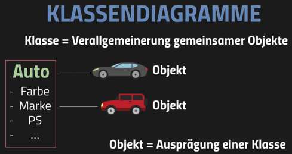
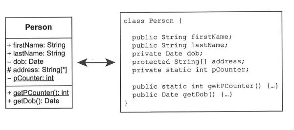
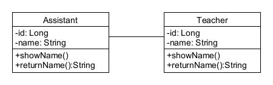
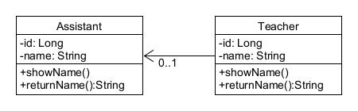
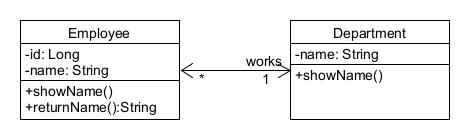
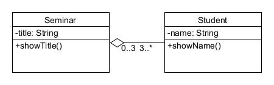
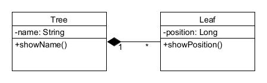
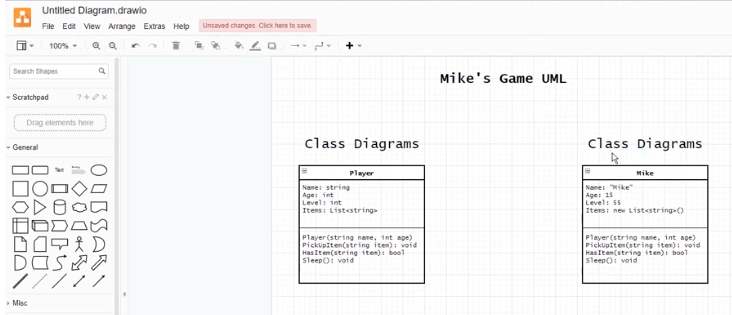
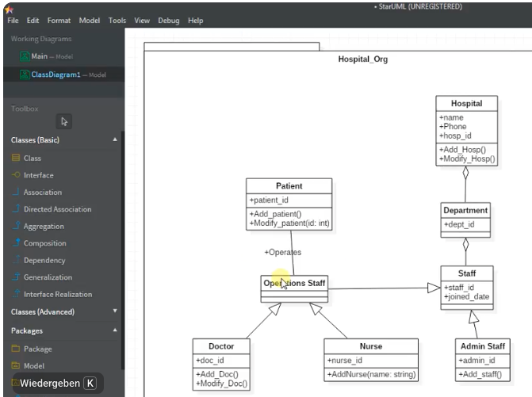

[TOC]

# UML Klassendiagramm

---

### Lernziel:
* Was ist UML?
* Was ist ein Klassendiagramm?
* Bedeutung der Symbole

--- 

## Einführung

Die **Unified Modeling Language** (vereinheitlichte Modellierungssprache), kurz **UML**, ist eine standardisierte, grafische Modellierungssprache zur Spezifikation, Konstruktion, Dokumentation und Visualisierung von Software-Teilen und anderen Systemen. Sie besteht aus verschiedenen Diagrammtypen: *Aktivitätsdiagramm, Anwendungsfallsdiagramm, Klassendiagramm, Sequenzdiagramm* und weitere ...

 [Wikipedia](https://de.wikipedia.org/wiki/Unified_Modeling_Language#Aktivit%C3%A4ten)

Ein **Klassendiagramm** (KD) ist ein Modell für eine Applikation, welche Objekt-orientiert und somit mit Klassen geschrieben ist. Ein Klassendiagramm zeigt dabei eine statische Übersicht über alle Klassen einer Applikation. Dabei können auch die **Beziehungen** (Assoziationen) zwischen den Klassen dargestellt werden.

Die unterschiedlichen Komponenten eines Klassendiagramms können die zu programmierenden Klassen, die Hauptobjekte oder die Interaktionen zwischen Klassen und Objekten darstellen. 

### Aufbau einer Klasse

Die Form einer Klasse besteht aus einem Rechteck mit drei Reihen. Die oberste Reihe enthält den Namen der Klasse, die mittlere Reihe gibt ihre Attribute an, und die unterste Reihe gibt Aufschluss über die Methoden oder Abläufe innerhalb der Klasse. Klassen und Unterklassen werden gruppiert, um die statische Beziehung zwischen den einzelnen Objekten zu verdeutlichen.

Hier ist ein Beispiel eines Klassendiagramms im Vergleich zu Java Code:

In diesem Beispiel sieht man den Aufbau einer Klasse.
Jede Klasse wird in drei Bereiche eingeteilt:
1. Name der Klasse
2. Attribute der Klasse (inkl. Symbol für Access Modifier)
3. Methoden der Klasse

### Die wichtigsten, standardisierten Symbole für Beziehungen (HAT und IST)

| Symbole | Bedeutung | Anwendung |
|:---:|---|---|
||unspezifizierte HAT-Beziehung|Beschreibt eine Assoziation|
||spezifizierte HAT-Beziehung|Beschreibt eine Assoziation genauer durch Pfeil (und wenn nötig Kardinalitäten)|
||bidirektionale HAT-Beziehung|Beide Klassen kennen einander|
||Aggregation|Die Assoziation beschreibt eine *is-part-of* Beziehung|
||Composition|Die Assoziation beschreibt eine existentielle *is-part-of* Beziehung, d.h. die Teile sind vom Ganzen abhängig (wenn der Baum stirbt, sterben auch dessen Blätter)|

Wir werden für die Kompetenz D2 den Unterschied zwischen Aggregation und Komposition im Java Code kennenlernen.

---

### Tutorial:

Hier ein Tutorial zur Vertiefung:
https://www.visual-paradigm.com/guide/uml-unified-modeling-language/uml-class-diagram-tutorial/

---

 To Do:

## Wahl eines UML-Tools:

Werkzeuge, um Klassendiagramme darzustellen:  
*Achtung: Symbolik muss korrekt sein! Bei einigen Tools fehlen gewisse Symbole!*
		
**DrawIO** (Empfohlenes Tool UML >> UML 2.5 öffnen): <https://https://app.diagrams.net/>
*Hinweis: Verwenden Sie die Vorlage "AD Symbols.drawio"*

**StarUML** (Freies ProfiTool WIN/mac): <http://staruml.io/>

**Modelio** (Freies Profitool WIN) : <https://www.modelio.org/>

**UMLet** (UMLetino online): <https://www.umlet.com/>

**Violet** (Erzeugt Html-Diagramme, braucht Java 8): <http://alexdp.free.fr/violetumleditor/page.php>

**Visual Paradigm Online Editor** (Freies Profitool): <https://online.visual-paradigm.com/de/diagrams/solutions/free-activity-diagram-editor-online/>

Oder natürlich auch **MS Visio** ([>>> TBZ EDU](https://portal.azure.com/#blade/Microsoft_Azure_Education/EducationMenuBlade/software)) oder andere Graphikprogramme.

---

## Einführung KD mit DrawIO

[Tutorials Drawio](https://drawio-app.com/tutorials/)
---

## Einführung KD mit StarUML

[Doku StarUML Calss-Diagrmm](https://docs.staruml.io/working-with-uml-diagrams/class-diagram)

---

## Kleine Übung

1. Erstellen Sie ein Klassendiagramm mit der korrekten Notation von Ihrem Programm, welches Sie für **D1** erstellt haben. Zeichnen Sie auch die korrekten Beziehungen zwischen den Klassen.
2. Bilden Sie den Code für folgende Beziehung ab:
 

---

# Checkpoint
* Ich kenne die Symbole für ein Klassendiagramm (Standard UML 2.5+!)
* Kann ein einfaches Klassendiagramm lesen und verstehen.
* Ich kenne die Beziehungsarten (HAT und IST) und kann diese erklären.
* Ich kann Klassendiagramme mit einem Tool erstellen

