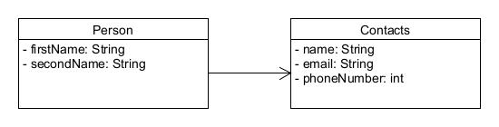

[TOC]

# Formen von Assoziationen

---
### Lernziel: 
* Ich kenne die unterschiedlichen HAT-Beziehungen
* Ich kann diese im Code umsetzen

-- 

## Assoziationen generell

Assoziationen zeigen Beziehungen zwischen Klassen. Sie beschreiben welche Klassen miteinander kommunizieren. Wir können dabei von HAT-Beziehungen reden, aber auch IST-Beziehungen sind eine Form von Assoziation (das sehen wir genauer, wenn wir über Vererbung sprechen.).
Wir wollen hier die HAT-Beziehungen etwas genauer anschauen.

Bestehen zwischen Objekten von Klassen Beziehungen, dann spricht man von **Assoziationen**. Dabei kennen sich die Objekte, existieren aber unabhängig voneinander. Ein Objekt, das ein anderes Objekt kennt, verwaltet dieses nicht.
Im Code zeigt sich das, indem die andere Klasse als Attribut aufgeführt wird:

```
public class Customer {
	
	String name;
	Account myAccount;
	

}
```
Wir verweisen in der Klasse *Customer* auf die Klasse *Account*, indem wir diese als Attribut festlegen.
Somit stellen wir die Beziehung *Kunde hat ein Konto* im Code dar.

Eine Beziehung kann dabei **unidirektional** (uni-directional) oder **bidirektional** (bi-directional) sein.

Im obigen Beispiel hat die Klasse *Account* nicht eine Referenz auf *Customer* und ist somit **unidirektional**. Wenn die Beziehung bidirektional ist, hat auch *Account* das Attribut *Customer*.


## 1:n Beziehungen

Ein Kunde kann natürlich auch mehrere Konten haben. Eine solche 1:n Beziehung bilden wir dann mit **Listen** im Code ab.


## Aggregation

Die Aggregation ist eine Sonderform der Assoziation zwischen zwei Klassen. Sie liegt dann vor, wenn zwischen den Objekten der beteiligten Klassen eine Beziehung vorliegt, die sich als „ist Teil von", „besteht aus“ oder einfach „hat“ beschreiben lässt.

Aggregationen sind festere Beziehungen zwischen Objekten als die oben beschriebene Assoziation, z. B. wenn eine Rangordnung zwischen den Objekten besteht.

Im Code sieht man das, wenn wir ein Objekt der anderen Klasse durch eine Methode (oder häufig) durch den Konstruktor als Parameter übergeben, um diese Objekte zu verändern:

```
public class Cloud {
	
	//attributes:
	private Circle element1;
	private Circle element2;
	private Circle element3;
	
	public Cloud(Circle c1, Circle c2, Circle c3){
		
		element1 = c1;  
		element2 = c2;
		element3 = c3;
		
		element1.changeColor("grey");
		element2.changeColor("grey");
		element3.changeColor("grey");
		
		element1.moveUp();
		element2.moveRight();
		element3.moveDown();
		
		element1.makeVisible();
		element2.makeVisible();
		element3.makeVisible();
	}

```
Hier erhält die Klasse *Cloud* bereits existierende Objekte von der Klasse *Circle* und verwendet diese, um die Wolke darzustellen und sichtbar zu machen. Wir sprechen in diesem Fall von Aggregation.

Die Unterscheidung zwischen Assoziation und Aggregation ist fliessend. Als wichtiges Merkmal gilt jedoch, dass das Objekt als Parameter übergeben wird (nicht nur in getter und setter-Methoden).


## Komposition

Die Komposition ist eine **Sonderform der Aggregation**. Sie drückt aus, dass die Teile von der *Existenz des Ganzen* abhängig sind.

Beispiele für eine Komposition sind:

*Dokument hat Inhaltsverzeichnis und Seiten* (ohne Dokument existieren die anderen Teile nicht)
*Baum hat Blätter* (ohne den Baum gibt es keine Blätter)
*Tisch hat Tischplatte und Tischbeine*
etc.

Im Code sehen wir eine Komposition, wenn das Objekt einer Klasse *innerhalb einer anderen Klasse* instanziiert wird. Somit existiert das Objekt nur, wenn auch das Objekt der anderen Klasse existiert.

Hier ein Beispiel, nochmals mit der Wolke:

```
public class Cloud {
	
	//attributes:
	private Circle element1;
	private Circle element2;
	private Circle element3;
	
		public Cloud(){
		element1 = new Circle();  //objects are instantiated
		element2 = new Circle();
		element3 = new Circle();
		
		element1.changeColor("grey");
		element2.changeColor("grey");
		element3.changeColor("grey");
etc.
```


## Kleine Übung

HAT-Beziehung: Setzen Sie folgendes UML Klassendiagramm in Code um.  Schreiben
Sie danach ein Hauptprogramm mit der main-Methode, das drei Personen mit je zwei Kontaktdaten abfüllt, und diese anschließend auf der Konsole wieder ausgibt.
   



## Quellen und weiterführende Links

Buch: Objekte und Klassen, P. Gressly
https://info-wsf.de/assoziation-aggregation-und-komposition/#Uni-_und_bidirektionale_Assoziationen

---

# Checkpoint
* Ich kenne die Unterscheidung zwischen Assoziationen, Aggregation und Komposition
* Ich weiss was eine unidirektionale und bidirektionale Beziehung ist
* Ich kann Formen von Assoziationen im Code erkennen und auch implementieren
