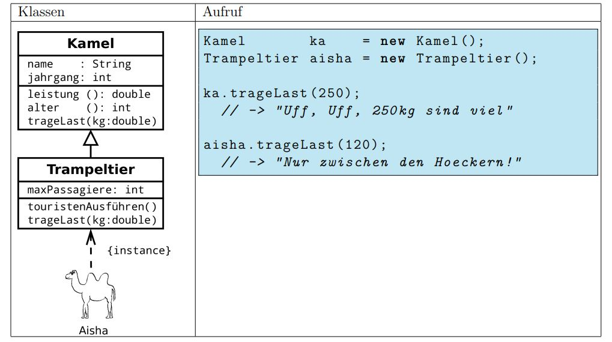
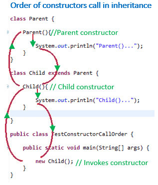
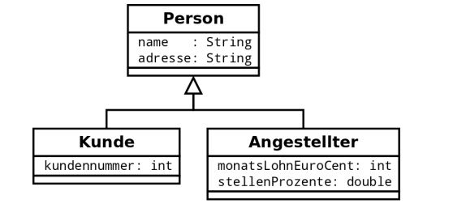

[TOC]

# Mehr über Vererbung: Überladen, Überschreiben und Polymorphismus

---
### Lernziel: 
* Ich kenne den Unterschied zwischen Methoden überladen und überschreiben
* Ich kann das Prinzip des Polymorphismus erklären
* Ich kann Dynamic Binding erklären
* Ich kann Type Casting im Zusammenhang mit Vererbung erklären

-- 

## Mehr über Vererbung

Wir haben gesehen, dass die Vererbung eine *Spezialisierung* im Code abbildet. Dabei erben die Subklassen die Attribute und Methoden der Superklasse.


## Überschreiben von Methoden

Subklassen können ihre eigenen Methoden haben, um ihr eigenes *spezielles* Verhalten umzusetzen.
Wir können diese Spezialisierung auch weiterführen, indem die Subklassen geerbte Methoden **überschreiben (overriding)**. Somit hat die Subklasse dann ein *spezialisiertes* Verhalten.

Ein Beispiel:



Hier überschreibt das Trampeltier die Methode *trageLast(double kg)* und setzt ein eigenes Verhalten um. Es könnte z.Bsp. darauf beharren, dass die Last nur zwischen Höckern getragen wird.


## Überladen von Methoden

Das **Überladen (overloading)** von Methoden hat selbst nichts mit Vererbung zutun. Sie können das auch in prozeduralen Sprachen umsetzen, wo z.Bsp. mehrere gleichnamige Funktionen geschrieben werden.
Beim Überladen gibt es **mehrere gleichnamige Methoden mit gleichem Returntyp**. Einziger Unterschied sind die Anzahl und Typen von Parameter.
Auch wenn die Methoden unterschiedliche Returntypen haben, wird das als Überladen bezeichnet.

Beispiel von korrektem Überladen:

```
add(int, int)
add(int, int, int)
```
Beispiel von falschem Überladen, was zu einem *Kompilierfehler* führt:
```
int add(int, int)
float add(int, int)
```

Das Überladen von Methoden wird auch als **statischer Polymorphismus** bezeichnet (static polymorphism), da zur Kompilierzeit der entsprechende Methoden-Aufruf umgesetzt wird. Wir werden weiter unten sehen, was ein dynamischer Polymorphismus ist.


**Überladen von Konstruktoren**

Dasselbe Prinzip kann natürlich auch auf den Konstruktor angewendet werden. Eine Klasse kann mehrere Konstruktoren haben - und somit werden auch diese überladen.


## Polymorphismus

Bevor wir dieses Thema im Code anschauen, lohnt es sich, den Begriff selbst genauer zu betrachten:

* Poly = verschiedene, viele
* Morphs = Formen, Gestalten

Vereinfacht gesagt, haben wir es hier mit *Vielgestaltigkeit* zutun. 
Man spricht von **dynamischem Polymorphismus**, wenn wir einer Referenzvariable
einer Klasse auch Objekte von Subklassen, also Spezialisierungen, dieser Klasse zuordnen können.

Beispiel:

```
Media video = new Video("Falling Down", "John Schlesinger");
```

Da *Media* die Superklasse von *Video* ist, können wir eine Variable von der Superklasse problemlos der Subklasse zuweisen.

## Aufruf von überschriebenen Methoden

Wenn nun die Subklassen eine Methode überschreiben, wird dieses Verhalten entsprechend beim Aufruf der Methode ausgeführt.
In diesem Beispiel führt die *Database* Klasse eine Liste von Medien. Hinter jedem Media Objekt versteckt sich z.Bsp. ein CD-Objekt oder ein DVD-Objekt, etc.

```
public class Database {
	
	private ArrayList<Media> media;   //this can be CD, DVD, etc.
	
	//constructor
	public Database() {
		media = new ArrayList<Media>();
	}
		
	public void addMedia(Media md) {
		media.add(md);
	}

	/**
	 * This method demonstrates POLYMORPHISM: each subclass reacts differently to 
	 * the same print-method
	 */
	public void printList() {
		
		//one loop for all:
		for (Media md : media) {
			md.print(); //depending on the type of object, the print-out is different => example of POLYMORPHISM
		}
	}
}

```
Falls nun jede Subklasse die print()-Methode überschrieben hat, wird beim Aufruf der Methode das entsprechende *spezialisierte Verhalten* ausgeführt.

### Tutorial Polymorphismus

Ein gutes Tutorial mit Beispiel zu Polymorphismus befindet sich hier: https://www.youtube.com/watch?v=jhDUxynEQRI


## Dynamic Binding

Im Zusammenhang mit Polymorphismus taucht auch der Begriff *Dynamic Binding* auf.
Wenn eine Methode polymorph ist, wird zur Laufzeit des Programms entschieden, welche Methode aufgerufen wird.
Hier ein Beispiel:


```
public class Animal {

    static Logger logger = LoggerFactory.getLogger(Animal.class);

    public void makeNoise() {
        logger.info("generic animal noise");
    }

}

public class Dog extends Animal {

    static Logger logger = LoggerFactory.getLogger(Dog.class);
    
    @Override
    public void makeNoise() {
        logger.info("woof woof!");
    }

}

```
In diesem Beispiel wird die Methode *makeNoise* überschrieben in der Sub-Klasse. (Quelle: Baeldung)
Zur Laufzeit des Programms wird anhand des tatsächlichen Objekttyps *Dog* entschieden, welche Methode ausgeführt wird:

```
// assigning a dog object to reference of type Animal
Animal dogAnimal = new Dog();

dogAnimal.makeNoise();

```
Dies ist ein Beispiel von Dynamic Binding. 
Mehr dazu bei Baeldung: https://www.baeldung.com/java-static-dynamic-binding


## Type Casting
Im Zusammenhang mit einer Vererbungs-Hierarchie kann auch das **Casting** (Typenkonversion) angewendet werden. </br>
Nochmals das Beispiel mit der Super-Klasse *Animal*:

```
public class Animal {

    public void move() {
       System.out.println("moves");
    }
}

public class Spider extends Animal {

    @Override
    public void move() {
        System.out.println("Spider moves quickly");
    }

	public void spinWeb() {
		System.out.println("Web in progress");
 }
}

public class Turtle extends Animal {

    @Override
    public void move() {
        System.out.println("Turtle moves very slow");
    }
}

```
Wir erstellen folgende Objekte:

```
Animal a1 = new Spider();  //upcasting spider to animal
Animal a2 = new Turtle();  //upcasting turtle to animal
```
Das sog. *upcasting* ist erlaubt, da jede Spinne oder Schildkröte ein Tier ist.
```
Animal a = new Spider();
Spider spider = (Spider) a;  //this is valid
```
dieses *downcasting* ist erlaubt, weil Objekt a auf ein Spider Objekt verweist.
```
Animal a = new Turtle();  //upcasting
Spider s = (Spider) a  //incorrect downcasting
s.spinWeb();  //ERROR at runtime - ClassCastException
```
Dieses *downcasting* geht nicht.

## Reihenfolge des Konstruktoren-Aufrufs
In einer Vererbungs-Hierarchie wird zuerst der Konstruktor der Super-Klasse aufgerufen, bevor der Konstruktor der Sub-Klasse aufgerufen wird. 




*Achtung: Wenn der Superklassen-Konstruktor eine Methode aufruft, die in der Subklasse überschrieben ist, dann wird aufgrund des dynamischen Bindens die überschreibende Methode der Subklasse ausgeführt, und zwar während der Ausführung des Superklassen-Konstruktors. Das kann gefährlich sein, weil die Subklassen-Felder zu diesem Zeitpunkt noch nicht initialisiert sein könnten.*


## Kleine Übung mit polymorpher Methode
 
Gegeben ist folgendes Klassendiagramm:


Ergänzen Sie das Klassendiagramm (in jeder Klasse) um eine Methode *ausgeben()* , die alle Attribute einer Person auf die Konsole ausgeben kann. Implementieren Sie die drei Klassen.
Schreiben Sie danach ein Programm, das in einem Array personen (des Basistyps Person) sechs
Personen speichern kann. Füllen Sie zwei unspezifische Personen, zwei Kunden und zwei Angestellte dem Array hinzu. Rufen Sie entsprechend die Methode *ausgeben()* aus.


---
## Quellen und weiterführende Links

* Buch Klassen und Objekte, P. Gressly
* https://beginnersbook.com/2013/05/method-overloading/
* https://www.w3schools.com/java/java_polymorphism.asp
* Dynamic binding: https://www.baeldung.com/java-static-dynamic-binding
* Reihenfolge des Aufrufs von Konstruktoren: https://interviewsansar.com/order-execution-constructors-java-inheritance/
  
  
  

---

# Checkpoint
* Ich kann zwischen Überladen und Überschreiben von Methoden unterscheiden und das im Code anwenden
* Ich verstehe den Unterschied zwischen statischem und dynamischem Polymorphismus
* Ich kann den dynamischen Polymorphismus in meinen Beispielen anwenden
* Ich verstehe das Konzept von Dynamic Binding
