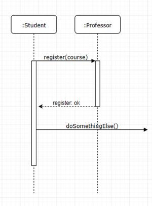
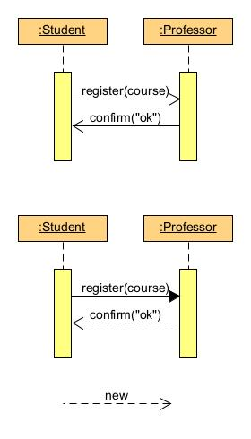

[TOC]

# Statische vs dynamische UML Diagramme

---
### Lernziel: 
* Ich kenne den Unterschied zwischen statischen und dynamischen Diagrammen
* Ich kenne die Notation des UML Sequenzdiagramms
* Ich kann einen Use Case in einem Sequenzdiagramm abbilden 

-- 

### Statisches Diagramm: UML Klassendiagramm

Mit dem Klassendiagramm bildet man die *Landschaft* des Designs ab und zeigt dabei die **Beziehungen** zwischen den Klassen auf (HAT-Beziehungen oder IST-Beziehungen).

Dabei können Klassendiagramme vereinfacht oder detailiert gezeichnet werden, wie diese Beispiele veranschaulichen:

//TODO

---

### Dynamisches Diagramm: UML Sequenzdiagramm

Fokus beim Sequenzdiagramm ist wie die Objekte miteinander kommunizieren.
Idealerweise nimmt man einen **Use Case** (Anwendungsfall) und zeigt dann auf, wie die Objekte miteinander diesen Use Case umsetzen.

Ein einfaches Beispiel:

Das Beispiel zeigt, wie die Objekte *Student* und *Professor* miteinander kommunizieren. Dabei werden die **Methodenaufrufe** mit **Meldungspfeile** (Messages) verknüpft.

### Arten von Meldungen

Beim Sequenzdiagramm unterscheidet man zwischen **synchronen** und **asynchronen** Nachrichten. Hier eine Übersicht:

* Seq. Diagramm 1:  zeigt **asynchrone** Nachrichten. Der Student meldet sich z.Bsp. via e-Mail and und wartet somit nicht auf Rückmeldung. 
* Seq. Diagramm 2: zeigt **synchrone** Nachrichten. Hier wartet der Student auf die Rückmeldung, bevor weitergearbeitet wird.
* Objekt instanziieren: durch einen gestrichelten Pfeil und mit dem Wort *new()* kann das Instanziieren eines Objekts dargestellt werden (dies kann aber auch weggelassen werden, wenn das Instanziieren zu diesem Zeitpunkt klar aus dem Diagramm hervorgeht).
* Pfeil als Rückmeldung: wenn aus dem Kontext die Rückmeldung klar ist, kann dieser Pfeil auch ausgelassen werden (um das Diagramm zu vereinfachen).

---

# Checkpoint
* Ich kenne den Unterschied zwischen statischen und dynamischen Diagrammen
* Ich kann beide Varianten für mein Design umsetzen
* Ich kann anhand eines Use Cases ein Sequenzdiagramm darstellen
* Ich kenne die verschiedenen Notationen für die Darstellung von Meldungen
