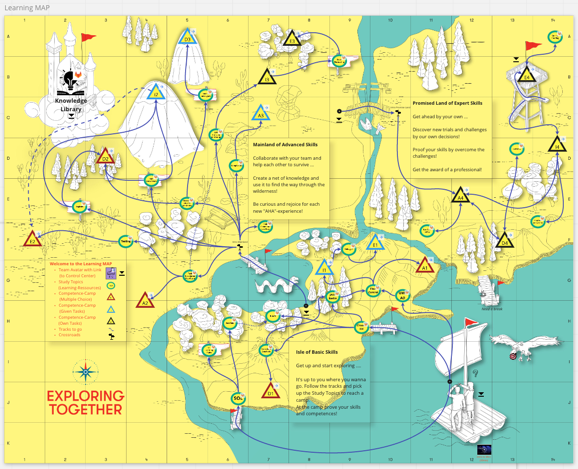

[TOC]

# m320 - Objektorientiert Programmieren

2.Lehrjahr: Q2 für AP

## Modulbeschreibung:

Applikationen und Schnittstellen objektorientiert modellieren, implementieren, testen und dokumentieren:

1. Analysiert Anwendungsprobleme zur Erstellung von objektorientierten Programmen.
2. Modelliert und dokumentiert objektorientierte Programme.
3. Implementiert objektorientiertes Design.
4. Überprüft die Implementierung auf Korrektheit und Qualität.

[Modul_ID und Kompetenzmatrix](https://gitlab.com/modulentwicklungzh/cluster-api/m320/-/blob/master/1_Kompetenzmatrix/README.md)

---

# Themen und Unterlagen

In folgenden Ordnern befinden sich die Unterlagen zu den Themenfeldern, welche auf dem Miroboard "Learning Map m320" mit den Symbolen  gekennzeichnet sind.

## Niveau 0: Einführung

Hier befinden sich die einführenden Themen, die zum Setup des Moduls gehören.

## Niveau 1: "Isle of Basic Skills"

Hier befinden sich die **Grundlagen** zum Modul. Desweiteren werden die Themen aus dem Modul 319 repetiert.

## Niveau 2: "Mainland of Advanced Skills"

Hier befinden sich die **zentralen Themen** des Moduls. Folgende Kapitel sollten **im Team** umgesetzt werden. 

- [N2-HAS_Relations](./N2-HAS_Relations): HAT-Beziehungen
- [N2-Inheritance_Overload_Overwrite](./N2-Inheritance_Overload_Overwrite): Das Konzept der Vererbung und Polymorphismus
- [N2-Inheritance_Overload_Overwrite](./N2-UML_Sequence_Diagramm): Unterschied zwischen statischen und dynamischen Darstellungen in UML (Klassendiagramm vs. Sequenzdiagramm).

## Niveau 3: "Mainland of Advanced Skills"
Im nächsten Niveau befassen wir uns noch genauer mit folgenden Themen:

- [N3-AbstractClass_Interface](./N3-AbstractClass_Interface): Abstraktionen in der OO-Welt. Unterschied zwischen Abstrakten Klassen und Interfaces.
- [N3-Delegation](./N3-Delegation): Delegation und wieso das manchmal besser ist als Vererbung
[N3-UnitTesting](./N3-UnitTesting): UnitTesting im Überblick

 
## Niveau 4: "Promised Land of Expert Skills"

In diesem Niveau setzen Sie das Gelernte an eigenen Produkten um und **vertiefen Ihr Können** dabei. Folgenden Kapitel sollten **einzeln** umgesetzt werden. 

- [N4-Abstractions](./N4-Abstractions): Abstrakte Klassen und Interfaces
- [N4-](https://refactoring.guru/design-patterns): DesignPatterns
- [N4-CleanCode](./N4-CleanCode): CleanCode

